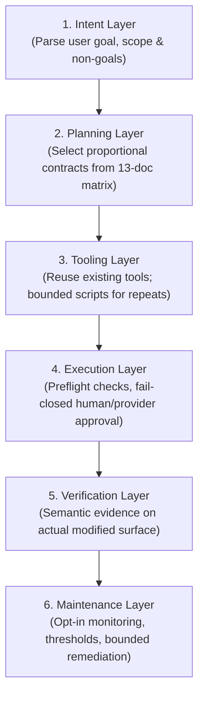
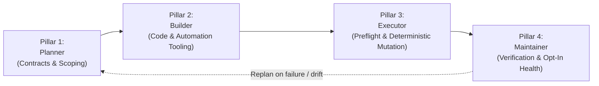

# Deterministic Agentic Workflow

Operate AI agents using the core architectural axiom: **"Otaknya boleh generative, tangannya harus deterministic."**
Generative cognitive capabilities are reserved for reading context, analyzing intent, designing plans, structuring contracts, and synthesizing solutions. All state mutation, system modification, deployment, migration, and verification must execute through deterministic scripts, bounded tools, and verifiable proof gates.

> **Instructional Contract Notice:** This skill is an instructional engineering guideline for agents and orchestrators. It does not install runtime system hooks, daemon supervisors, or automated enforcement interceptors. Deterministic execution tools and scripts do not automatically guarantee semantic success; truthful verification requires inspecting observable runtime evidence against Acceptance Criteria. Documents alone never constitute running background services or deployment authorization.

Article Reference: Rama Digital — _Agentic Tapi Deterministic Workflow AI Agent_ (https://ramadigital.id/blog/agentic-tapi-deterministic-workflow-ai-agent).
_Advice separation note:_ Core article principles (generative planning, deterministic execution, document contracts, and verification gates) establish the architectural foundation. Local operational additions in this skill (specific specialist skill routing, fail-closed approval triggers, multi-tenant semantic verification, and opt-in background maintenance bounds) adapt these tenets to multi-agent CLI and workstation environments.

---

## 1. The Six Operational Responsibilities

A robust agentic workflow separates concerns across six distinct operational layers:

1. **Intent Layer:** Parse natural language into structured, unambiguous requirements without assuming unstated scope. Explicitly define what is in scope and what is out of scope.
2. **Planning Layer:** Map tasks to proportional document contracts selected from the 13 specification types (1 blueprint + 12 derivative specifications). Never write implementation code before contracts are set.
3. **Tooling Layer:** Reuse existing repository tools, test suites, and package manager commands first. Wrap complex multi-step tasks executed repeatedly into standalone CLI scripts with native or meaningful dry-run/simulation validation where supported (never invent fake flags).
4. **Execution Layer:** Run deterministic commands through relevant preflight checklists, explicit immutable rollback points, and fail-closed human/provider approval gates for high-impact mutations.
5. **Verification Layer:** Require truthful, observable semantic evidence on the actual surface modified (APIs, CLI, UI, DB) matching Acceptance Criteria—never accept superficial HTTP 200 or raw exit code 0 alone.
6. **Maintenance Layer:** Provide opt-in, bounded background monitoring and remediation with strictly defined metrics, rate limits, kill-switches, and immediate stop-and-replan escalation. Never claim an active monitor exists without observing running processes and sample telemetry.

---

## 2. The Four Iterative Pillars

Execution is neither a single waterfall pass nor an unguided loop; it follows four iterative agentic roles:

- **Pillar 1: The Planner (Scoping & Contracts):** Synthesizes intent into proportional specification contracts from the 13-doc matrix. Establishes boundaries, acceptance criteria, and non-goals. Re-evaluates contracts when upstream requirements change.
- **Pillar 2: The Builder (Implementation, Tools & Automation):** Develops application code, configures bounded automation scripts, and wraps repeatable tasks into deterministic tools per the article's core tenets. Adapts to existing repository patterns and avoids gratuitous abstractions.
- **Pillar 3: The Executor (Gated State Mutation):** Applies mutations (migrations, builds, deployments, environment updates) through deterministic scripts and tools. Evaluates relevant preflight checks, verifies immutable snapshots, and halts fail-closed for point-of-risk approvals.
- **Pillar 4: The Maintainer (Verification & Operational Health):** Proves semantic correctness against acceptance criteria on actual modified surfaces. Manages opt-in monitoring, triage, and bounded remediation loops. Escalates unexpected failures back to the Planner.

---

## 3. Proportional Document Matrix (1 Blueprint + 12 Derivatives)

The workflow defines **13 available document types** categorized by system lifecycle. These represent available contract types, **not a mandatory bundle**.

Agents select only the proportional contracts demanded by the actual impact of the task:

- **Routine bugfixes or minor patches:** Require NO new specification documents unless a real material gap exists. Reuse the existing issue description, test assertions, or a concise verification record.
- **Internal / backend changes (e.g., internal BRD or API refactor):** Require only contracts relevant to the actual architectural, business, and operational impact (e.g., `prd.md`, `frd.md`, `techstack.md`, `security.md`, or `runbook.md` as appropriate). Do NOT generate irrelevant frontend, SEO, or UX contracts.
- **Frontend / user-facing changes with security impact:** If a frontend modification touches authentication, session tokens, CSRF, or sensitive data display, it MUST trigger security evaluation via a security contract (`security.md`) or equivalent existing repository security specification alongside interface contracts.
- **Major new features or systems:** Begin with `blueprint.md`, then derive the relevant sub-specifications.

### Specification Index & Templates

The 13 document templates are located in `templates/`:

1. **System Core:**
   - [Blueprint Template](templates/blueprint.md) (`blueprint.md`) — System architecture, cross-cutting invariants, core domain topology.
2. **Business & Requirements:**
   - [BRD Template](templates/brd.md) (`brd.md`) — Business goals, ROI, constraints, high-level user personas.
   - [PRD Template](templates/prd.md) (`prd.md`) — Product requirements, user stories, acceptance criteria, scope boundaries.
   - [FRD Template](templates/frd.md) (`frd.md`) — Functional specifications, detailed field schemas, business logic rules.
3. **Architecture & Design:**
   - [Tech Stack Template](templates/techstack.md) (`techstack.md`) — Technologies, libraries, frameworks, architectural constraints.
   - [Design Template](templates/design.md) (`design.md`) — Visual design tokens, layout primitives, styling foundations, and accessibility (a11y) visual standards.
   - [Wireframe Template](templates/wireframe.md) (`wireframe.md`) — Structural screen layout, visual hierarchy, responsive viewports.
   - [UI/UX Template](templates/ui-ux.md) (`ui-ux.md`) — Interaction design, user flows, interactive states, and behavioral accessibility.
4. **Governance & Operations:**
   - [Security Template](templates/security.md) (`security.md`) — Threat model, auth/authz boundaries, data protection, compliance.
   - [Roadmap Template](templates/roadmap.md) (`roadmap.md`) — Release milestones, delivery phases, dependencies.
   - [Deployment Template](templates/deployment.md) (`deployment.md`) — CI/CD pipelines, environments, infrastructure, health checks.
   - [QA Template](templates/qa.md) (`qa.md`) — Test strategy, test matrix, edge cases, acceptance proof checklists.
   - [Runbook Template](templates/runbook.md) (`runbook.md`) — Operational procedures, incident triage, alerting, recovery.

For complete routing rules, handoff schemas, and skill mapping, consult the [Routing Reference](references/routing.md).

---

## 4. Operational Guardrails: Approvals, Rollback, Tools & Verification

All state mutation and runtime actions must follow the protocols detailed in the [Operations Reference](references/operations.md):

1. **Preflight Verification & Workspace Coexistence:**
   - Confirm relevant target environment and revision/content hash before executing mutation commands without demanding external cloud context for local file edits.
   - Adapt to existing uncommitted or untracked user changes; do not abort solely due to a dirty tree. Never stash, overwrite, or delete unrelated work; halt only if direct file collisions exist.
2. **Fail-Closed Approval at Point of Risk:**
   - Planning documents and sign-offs **do not** constitute authorization.
   - Reviewed inactive drafts are distinct from active apply, publish, or auto-triggered commands.
   - High-impact mutations (shared database DDL, production deployments, secret changes, protected branch pushes) require fresh interactive confirmation at the point of risk. Disposable local test fixtures and routine authorized local edits do not require redundant prompts.
   - If confirmation is unavailable or non-interactive, execution halts fail-closed.
3. **Approval Invalidation on Drift:**
   - Any prior approval is voided if target environment, tenant context, Git commit SHA, baseline state, or planned command arguments change. Halt and re-confirm.
4. **Safe Rollback with Explicit Snapshots:**
   - Re-deploying a known-good release artifact is distinct from creating a `git revert` commit. Choose the strategy suited to the failure domain.
   - When stateful data recovery is explicitly selected, rollbacks must name verified pre-change snapshot IDs checked for integrity, schema compatibility, and restoration viability. For stateless application-only rollbacks, re-deploy the immutable release artifact without invoking database restoration.
   - Never use floating pointers like `HEAD~1`, `latest`, or unverified "newest" backups.
   - Preserve unrelated user workspace modifications during rollbacks.
5. **Tool Reuse Over Compulsory Scripts:**
   - Prefer existing build tools, package managers, and CLI utilities over creating ad-hoc wrappers. Wrap in standalone scripts with dry-run or equivalent validation only where supported and when complex orchestration demands it.
6. **Semantic Verification & Secret Redaction:**
   - Verify Acceptance Criteria on the actual modified surface (API response payloads, CLI output, UI components, database state) rather than shallow status codes alone.
   - Maintain truthful audit records recording whether checks are `passed`, `failed`, `blocked`, or `unexercised`. Never claim passed verification for skipped or mocked checks.
   - Strictly redact all secrets, tokens, passwords, and sensitive customer data from command strings, error traces, and audit logs. Record key names/references only.
7. **Proactive Maintenance is Opt-In Only:**
   - Background maintenance loops require explicit human activation with configured monitoring sources, metrics, cadence, rate bounds, kill-switches, and escalation paths. Automated PR opening is disabled by default. Never claim a service is actively running without observed runtime state.

---

## 5. Delegation, Replan Loops, and Abort Protocols

### Delegation Paths & Boundaries

- Orchestrators delegate bounded tasks to domain specialists using the standard handoff schema defined in [Routing Reference](references/routing.md) (`objective`, `input_paths`, `input_revisions`, `decisions`, `open_issues`, `required_output_path`, `verification_checks`, `approval_boundaries`).
- Specialists must read their domain skill instructions before acting and must not exceed assigned scope.
- **Router Recursion Forbidden:** Specialized skills never call the general router recursively.
- **Missing Specialist Policy:** If a required specialist skill is unavailable, the agent CANNOT silently fall back to an unsuited specialist for high-risk work. Inlining is permitted ONLY if the agent possesses the capability and the task is low-risk; otherwise, report the exact blocker and complete reachable work.

### Replan Loops & Abort Rules

- **Partial Execution Failure:** If an execution step fails, do not continue down the script sequence and do not loop blind retries. Halt immediately, capture error diagnostics, and transition back to planning.
- **Stale or Conflicting Contracts:** If an upstream specification contradicts repository state or another contract, resolve the material gap with the user before touching implementation code.
- **Out-of-Scope Discovery:** If implementation uncovers unexpected architectural dependencies or security implications outside the current contract, pause execution, update the planning contracts, and re-establish approval boundaries.

---

## 6. Document References & Further Reading

- [Routing & Delegation Reference](references/routing.md) — Document handoff schemas, lifecycle routing, and domain skill delegation.
- [Operations & Verification Reference](references/operations.md) — Preflight checklists, fail-closed approvals, rollback mechanics, and maintenance boundaries.
- [Task Contract & Validator Reference](references/validation.md) — Task contract specification, CLI validator invocations, and verification schema.
- [Installation & Discovery Reference](references/installation.md) — Environment setup, package discovery, and agent skill integration.
- [Skill Change History](references/changes.md) — Changelog and audit remediation records.
- [Rama Digital: Agentic Tapi Deterministic Workflow AI Agent](https://ramadigital.id/blog/agentic-tapi-deterministic-workflow-ai-agent) — Source conceptual framework.
