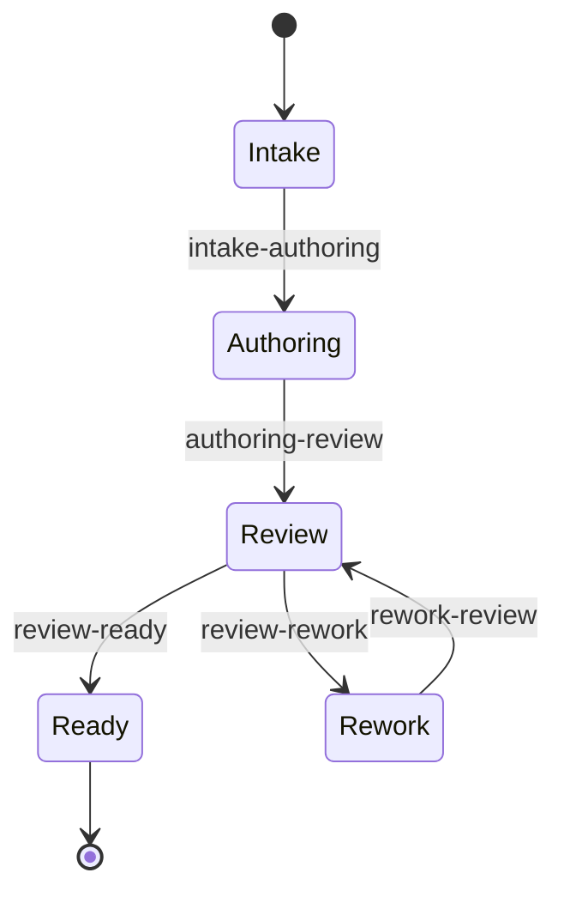

# Canonical Document Quality & Workflow Transition Specification

This specification defines the quality standards, evaluation criteria, and deterministic workflow transition gate for all Deterministic Agentic Workflow (DAW) specifications and engineering documents.

---

## 1. Overview & Architectural Role

### 1.1 Purpose

Engineering documentation in Deterministic Agentic Workflow (DAW) serves as the formal boundary contract between business intent, technical architecture, and autonomous implementation. High-quality documentation must be unambiguous, grounded in verifiable facts, free from vanity metrics, and consumable by two distinct reader audiences:

1. **Human Stakeholders:** Engineers, architects, product managers, security reviewers, and operations teams who review, govern, and maintain the system.
2. **Fresh Coding Subagents:** Autonomous LLM subagents spawned with clean context windows, zero ambient conversational history, and strict execution instructions.

### 1.2 Engineering Proposal Status: Workflow Transition Gate

This specification and its accompanying machine registry (`references/document-quality-rubric.json`) operate as an **engineering-proposal specification** and deterministic **workflow transition gate**:

- The gate governs document lifecycle state transitions through five explicit directed edges:
  `intake-authoring`, `authoring-review`, `review-ready`, `review-rework`, and `rework-review`.
- It enforces a portable, read-only Python stdlib gate (`scripts/doc_quality.py` invoked via `python3 scripts/validate.py docs`).
- It avoids global process supervisors, shell hooks, daemon listeners, or runtime monkeypatching.
- It verifies **structural transition eligibility**, not internal semantic truth or actual human comprehension.
- Passing the transition gate proves that a transition record and its cited artifacts satisfy structural requirements; the validator persists no state and cannot authenticate callers, reviewers, or actual lifecycle history. The parent orchestrator holds actual workflow state.

### 1.3 Scope & Proportionality

DAW defines **13 canonical document kinds**:
`blueprint`, `brd`, `prd`, `frd`, `techstack`, `design`, `wireframe`, `ui-ux`, `security`, `qa`, `deployment`, `runbook`, `roadmap`.

**There is no mandatory 13-document requirement.** Projects MUST author only the specific documents proportional to their scope, complexity, and active lifecycle stage. If a project requires only an architectural blueprint and an FRD, only those documents are selected, authored, and transitioned. Equivalent project-relative filenames are permitted for each canonical kind (for example, `docs/architecture-blueprint.md` for `blueprint` or `specs/functional-requirements.md` for `frd`).

---

## 2. Industry Standards & Practice Guidance Grounding

The DAW document quality criteria and workflow transition gate are grounded in established engineering practice guidance and industry standards.

| Source & Canonical Link                                                                                                                                                  | Focus                              | What It Supports in DAW Rubric / Gate                                                                                                                                             | Operational Limitations / Non-Goals                                                                                                                                                               |
| :----------------------------------------------------------------------------------------------------------------------------------------------------------------------- | :--------------------------------- | :-------------------------------------------------------------------------------------------------------------------------------------------------------------------------------- | :------------------------------------------------------------------------------------------------------------------------------------------------------------------------------------------------ |
| **NASA Systems Engineering Handbook (SP-2016-6105 Rev2, App C)**<br>[NASA SP-2016-6105 Rev2](https://www.nasa.gov/reference/appendix-c-how-to-write-a-good-requirement/) | Requirements engineering           | Verifiable, unambiguous requirements; bounded condition/action boundaries; separating problems from implementation bias (`brd`, `prd`, `frd`, `DQ-04`).                           | Aerospace mission formalism; does not certify agent code output or validate UI layouts.                                                                                                           |
| **Google Technical Writing: Target Audience**<br>[Google Tech Writing](https://developers.google.com/tech-writing/one/audience)                                          | Reader-centered communication      | Explicit reader roles, reader prerequisite knowledge, and core reader tasks; organizing key information without ambient memory (`DQ-01`).                                         | Human-targeted; does not model LLM context window attention limits or token degradation.                                                                                                          |
| **arc42 Architecture Documentation**<br>[arc42 Overview](https://arc42.org/overview/)                                                                                    | Modular architecture views         | Modular separation of concerns across system boundaries, building blocks, and decisions (`blueprint`, `techstack`).                                                               | Comprehensive enterprise framework; does not mandate authoring all 12 arc42 sections.                                                                                                             |
| **Documenting Architecture Decisions (Nygard)**<br>[Nygard ADR Pattern](https://cognitect.com/blog/2011/11/15/documenting-architecture-decisions)                        | Architecture Decision Records      | Recording architectural decisions with Context, Decision, and Consequences (`techstack-02`, `DQ-05`).                                                                             | Limited to architectural decisions; does not define operational runbooks or test strategies.                                                                                                      |
| **OWASP Threat Modeling Cheat Sheet**<br>[OWASP Threat Modeling](https://cheatsheetseries.owasp.org/cheatsheets/Threat_Modeling_Cheat_Sheet.html)                        | Threat discovery & mitigation      | Structured asset cataloging, trust boundaries, threat entry points, and actionable defenses (`security-01..03`).                                                                  | Methodological guide; does not prove absence of vulnerabilities or run automated audits.                                                                                                          |
| **Google Site Reliability Engineering: Release Engineering**<br>[Google SRE Book Ch 8](https://sre.google/sre-book/release-engineering/)                                 | Reproducible deployments           | Documented build/release steps, environment configuration, cutovers, and rollback playbooks (`deployment-01..03`).                                                                | Presumes distributed production infrastructure; does not prescribe single-node or CLI deployment rules.                                                                                           |
| **Google Site Reliability Engineering: Managing Incidents**<br>[Google SRE Book Ch 14](https://sre.google/sre-book/managing-incidents/)                                  | Incident triage & response         | Structured severity classification, triage escalation, and reproducible diagnostic procedures (`runbook-01..03`).                                                                 | Organizational incident management guidance; does not prevent underlying software failure.                                                                                                        |
| **Software Engineering at Google: Testing Overview (Adam Bender)**<br>[Google SWE Book Ch 11](https://abseil.io/resources/swe-book/html/ch11.html)                       | Test strategy & isolation          | Test level boundaries (unit, integration, system), environment isolation, and flakiness prevention (`qa-01..03`).                                                                 | Architectural testing philosophy; does not generate test code or verify domain logic.                                                                                                             |
| **W3C Web Content Accessibility Guidelines (WCAG) 2.2**<br>[W3C WCAG 2.2](https://www.w3.org/TR/WCAG22/)                                                                 | Visual & interaction accessibility | Exact testable accessibility criteria: text contrast (1.4.3), non-text contrast (1.4.11), Focus Visible (2.4.7), Focus Not Obscured (Minimum) (2.4.11) (`design-02`, `ui-ux-03`). | Applies to web UI presentation surfaces; not applicable to headless or CLI systems. Note: 2.4.7 ensures focus visibility; 2.4.11 ensures author content does not cover focused items.             |
| **Everything Claude Code (ECC) GateGuard Precedent**<br>[affaan-m/ECC](https://github.com/affaan-m/everything-claude-code)                                               | Fact-forcing mechanism precedent   | Historical precedent for requiring explicit empirical evidence before permitting operations.                                                                                      | Mechanism inspiration only. ECC uses runtime PreToolUse interceptor hooks; DAW uses static, read-only CLI validation without hooks. Universal LLM self-evaluation claims are explicitly rejected. |

---

## 3. Canonical Quality Rubric

The canonical machine-readable rubric is published at `references/document-quality-rubric.json` and serves as the **single authoritative source** for all 44 criterion IDs and text questions. This section summarizes the structure and reader outcomes.

### 3.1 Common Core Criteria (DQ-01 .. DQ-05)

Every document, regardless of kind, is evaluated against these 5 foundational criteria:

- **DQ-01 (Reader Role & Task):** Defines the explicit reader role and core reader task, enabling immediate orientation without ambient conversation memory.
- **DQ-02 (Observed Facts vs. Proposals):** Distinguishes observed empirical facts with verifiable provenance from proposals, assumptions, or unknowns.
- **DQ-03 (Terminology & Cross-Links):** Employs consistent domain terminology and canonical cross-links without conflicting duplicate definitions.
- **DQ-04 (Actionable Acceptance & Boundaries):** Formulates bounded, actionable acceptance criteria, failure modes, and dependencies proportional to scope.
- **DQ-05 (Scope Boundaries & Revision Context):** Clearly identifies scope boundaries, open decisions, and recorded revision context without forcing artificial dates or sign-offs.

### 3.2 Canonical Document Kinds (Summary of 3 Specific Criteria Each)

Detailed question texts are maintained canonically in `references/document-quality-rubric.json`:

1. **`blueprint` (`blueprint-01..03`):** High-level system boundaries and core components; document routing map without orphan links; cross-cutting contracts and governance invariants.
2. **`brd` (`brd-01..03`):** Core business objectives and target outcomes; stakeholder roles and workflow constraints; separation of business constraints from implementation details.
3. **`prd` (`prd-01..03`):** Primary actors/consuming systems and problem scenarios; product capabilities and flow priorities; functional success conditions and explicit non-goals.
4. **`frd` (`frd-01..03`):** Domain entities, data models, or payload schemas with types and validation; deterministic state transitions and event triggers; edge cases and error contracts.
5. **`techstack` (`techstack-01..03`):** Runtimes, frameworks, and storage systems with explicit versions and rationales; architectural trade-offs and decision records; dependencies and licensing boundaries.
6. **`design` (`design-01..03`):** Design tokens with semantic mappings; visual contrast and accessibility considerations (e.g. WCAG 1.4.3/1.4.11) where applicable; reusable component inventory and responsive layout rules.
7. **`wireframe` (`wireframe-01..03`):** Viewport layouts and responsive breakpoints; screen container hierarchy and spatial allocation; navigation flows, user cues, and view transitions.
8. **`ui-ux` (`ui-ux-01..03`):** Interactive component states (default, active, disabled, loading, error); interaction behaviors and progressive disclosure; keyboard navigation, ARIA semantics, Focus Visible (2.4.7), and Focus Not Obscured (2.4.11).
9. **`security` (`security-01..03`):** Sensitive assets and data boundaries; trust boundaries and threat vectors mapped to security patterns (e.g. OWASP); actionable authentication, authorization, and mitigation controls.
10. **`qa` (`qa-01..03`):** Test strategy across appropriate levels (unit, integration, system); test environments, fixtures, and isolation proportional to architecture; defect severity and regression gating rules.
11. **`deployment` (`deployment-01..03`):** Deployment topologies and release artifacts; reproducible release phases, health checks, and cutovers; rollback triggers, procedures, and migration reversibility.
12. **`runbook` (`runbook-01..03`):** Service operational profile, monitoring indicators, and alert thresholds; incident severity levels, triage paths, and roles; copy-paste executable diagnostic and recovery playbooks.
13. **`roadmap` (`roadmap-01..03`):** Sequenced, dependency-ordered work phases and milestones; critical path dependencies and integration choke-points; phase completion gates and release acceptance criteria.

---

## 4. Workflow Transition State Machine & Protocol

The document quality gate enforces an explicit lifecycle state machine governing how specifications move from inception through authoring, review, and downstream readiness.



### 4.1 The Five Allowed Directed Edges

The CLI parameter `--transition <edge>` and the record's `transition: {"from": "...", "to": "..."}` must match exactly one of the five allowed edges:

1. **`intake-authoring` (`intake` -> `authoring`):**
   - **Purpose:** Initiates document authoring. Verifies objective, scope, audience role, reader task, and grounded inception sources.
   - **File State:** Target document files **do not need to exist yet** on disk.
   - **Top Fields:** `schema_version`, `transition`, `objective`, `scope`, `documents`.
   - **Reviewer:** MUST NOT carry `reviewer`.
   - **Per-Document:** `path`, `kind`, `audience`, `reader_task`, `sources`. Does NOT carry `sha256` or `checks`.

2. **`authoring-review` (`authoring` -> `review`):**
   - **Purpose:** Submits authored documents for review. Verifies that regular UTF-8 files exist, byte SHA-256 hashes match disk bytes, and all 8 required criteria are addressed.
   - **File State:** Document file **must exist** as a regular UTF-8 file with matching SHA-256.
   - **Top Fields:** `schema_version`, `transition`, `objective`, `scope`, `documents`.
   - **Reviewer:** MUST NOT carry `reviewer` (authors cannot submit self-reviews).
   - **Checks:** Exactly 8 checks (5 common + 3 kind). Status may be `pass`, `not_applicable`, or `blocked`.
   - **Blocked Acceptance:** Grounded `blocked` checks are permitted to indicate unfinished sections or dependency blocks entering review. Checks MUST NOT carry `decision`.

3. **`review-ready` (`review` -> `ready`):**
   - **Purpose:** Downstream implementation release gate. Verifies that an independent reviewer or parent agent has evaluated all 8 criteria and accepted them.
   - **File State:** Document file must exist, with exact matching SHA-256.
   - **Top Fields:** `schema_version`, `transition`, `objective`, `scope`, `reviewer` (mandatory non-empty string), `documents`.
   - **Checks:** Every check MUST include `decision: "accepted"`.
   - **Status Restrictions:** Every check status MUST be `"pass"` or `"not_applicable"`. Any check with status `"blocked"` or decision `"not_accepted"` causes immediate transition rejection.

4. **`review-rework` (`review` -> `rework`):**
   - **Purpose:** Rejection / corrective feedback gate. Records reviewer objections and required remediation scope.
   - **File State:** Document file must exist, with exact matching SHA-256.
   - **Top Fields:** `schema_version`, `transition`, `objective`, `scope`, `reviewer` (mandatory non-empty string), `documents`.
   - **Checks:** Every check carries `decision: "accepted"` or `decision: "not_accepted"`.
   - **Rejection Requirement:** At least one check MUST carry `decision: "not_accepted"`. A review that accepts everything cannot transition to rework.

5. **`rework-review` (`rework` -> `review`):**
   - **Purpose:** Resubmission gate after author rework. Verifies updated artifacts and fresh quotes submitted for re-review.
   - **File State:** Document file must exist, reflecting reworked content with updated SHA-256.
   - **Top Fields:** `schema_version`, `transition`, `objective`, `scope`, `documents`.
   - **Reviewer:** MUST NOT carry `reviewer`.
   - **Checks:** Exactly 8 checks with status `pass`, `not_applicable`, or `blocked`. Checks MUST NOT carry `decision`.

---

### 4.2 Document Mutation & Verdict Invalidation

**A document or evidence mutation immediately invalidates any prior `review-ready` eligibility.**

- If any line in a specification file or cited source file is modified, its SHA-256 hash changes.
- The validator recalculates SHA-256 from disk bytes and verifies line-level quotes against current file text. If hashes or quotes do not match disk bytes, verification fails immediately.
- Any mutation requires the parent orchestrator to re-enter the `rework` state, submit a fresh `rework-review` transition record, and obtain a fresh `review-ready` transition record from the reviewer.
- There are no perpetual authorization tokens or lifetime exemptions.

---

## 5. Record & Evidence Schemas

### 5.1 Top-Level Transition Record Envelope (Schematic)

```json
{
  "schema_version": 1,
  "transition": {
    "from": "authoring",
    "to": "review"
  },
  "objective": "Design and document the core authentication service API contract and data model.",
  "scope": "Covers user registration, token issuance, and session revocation. Billing integration is out of scope.",
  "documents": []
}
```

_(Schematic illustration. Concrete transition records populate `"documents"` with specific document objects. The `"reviewer"` field is mandatory on `review-ready` and `review-rework` edges, and strictly prohibited on `intake-authoring`, `authoring-review`, and `rework-review`.)_

### 5.2 Evidence Citation Schema (Schematic)

Every source cited in `sources` and every evidence quote in `checks` must adhere to this exact structural format:

```json
{
  "path": "docs/architecture-blueprint.md",
  "sha256": "<64-hex-sha256-digest-of-exact-file-bytes>",
  "start_line": 12,
  "end_line": 13,
  "quote": "### Target Reader\nThis document is written for Backend Engineers implementing the service."
}
```

- `path`: Strict project-relative path to a regular UTF-8 file inside the project root.
- `sha256`: 64-character lowercase hex string matching `hashlib.sha256(file_bytes).hexdigest()`.
- `start_line` / `end_line`: 1-based positive integers, with `end_line >= start_line`.
- `quote`: Exact string resulting from `"\n".join(lines[start_line - 1 : end_line])`.

---

## 6. Operational Boundaries & Security Limitations

The DAW document transition gate enforces strict operational boundaries:

1. **Structural Transition Eligibility vs. Semantic Truth:**
   The validator evaluates whether the record complies with schema rules, whether cited lines exist in regular files, and whether hashes match disk bytes. It does **not** certify that the document's design is bug-free, that the architecture is optimal, or that requirements are completely understood. Passing the gate proves **eligibility for the declared transition**, not semantic truth.
2. **Read-Only Stateless Execution:**
   The validator never writes to the filesystem, executes child processes, makes network requests, or persists transition state. The parent orchestrator holds the actual lifecycle state.
3. **No Caller or Reviewer Authentication:**
   The `reviewer` string is opaque. The validator cannot verify the physical identity, cryptographic signature, or organizational independence of the reviewer. Parent workflows must independently verify reviewer competence.
4. **Human Comprehension Remains Unexercised:**
   In the absence of empirical human reading studies with real human participants, human comprehension **MUST BE EXPLICITLY REPORTED AS UNEXERCISED**. Substituting LLM self-evaluation or synthetic prompt completions as "human readability validation" is prohibited.

---

## 7. Two-Audience Evaluation Protocol

To empirically measure documentation usability and clarity across human and agent readers:

### 7.1 Evaluated Audiences

- **Audience A (Human Engineers / Stakeholders):** Human developers and architects tasked with reviewing, understanding, and implementing specifications.
- **Audience B (Fresh Coding Subagents):** Autonomous LLM subagents initialized in isolated sessions with clean context windows, zero prior conversational turns, and no access to planning memory.

### 7.2 Audience-Tailored Evaluation Tasks

Tasks must be tailored to the document's actual target reader role and scope rather than imposing arbitrary universal constraints:

1. **Targeted Information Retrieval & Constraint Mapping:**
   - _Task:_ Locate and state the exact interfaces, constraints, and error behaviors specified for the target reader's role.
   - _Measurement:_ Record elapsed retrieval time and steps without imposing a fixed universal threshold; if a time budget is used, pre-register the budget based on document size. Compare extracted facts against the specification oracle.
2. **Bounded Implementation & Test Authoring:**
   - _Task:_ Implement the designated module or test suite strictly within bounded, permitted paths without guessing missing parameters or inferring out-of-scope abstractions.
   - _Measurement:_ Zero unauthorized path modifications, zero ungrounded interface assumptions, full test pass rate against documented contracts.
3. **Operational Diagnosis, Approval Gates & Escalation:**
   - _Task:_ Follow documented runbooks to diagnose a simulated degraded condition, identifying the correct root cause and appropriate mitigation path.
   - _Measurement:_ Verifies that operational steps correctly pause at approval boundaries, invoke mandatory human confirmation, and trigger escalation paths rather than executing unapproved mutations or automatic remediation.

### 7.3 Experimental Controls & Methodology

- **Withheld Expected Answer Oracle:**
  The ground-truth answers (oracle) must be maintained separately from the evaluation environment and strictly withheld from evaluating agents during the test run.
- **Negative Controls & Transparent Failure Reporting:**
  Test suites must include negative controls (intentionally flawed, ambiguous, or incomplete specifications). Evaluators must explicitly record and report whether the reader or reviewer detected the defect; detected failures must be documented transparently rather than hidden or treated as evaluation invalidation. Automated CLI gates only evaluate structural eligibility, so semantic defect detection remains the responsibility of the reviewer.
- **Fresh Context Windows & Contamination Disclosure:**
  Subagents must be evaluated in isolated runs without prior conversation history. Because fresh sessions do not erase pre-existing host environment artifacts, global caches, or training-data exposure, any potential background context contamination must be explicitly disclosed in the evaluation report.
- **Honest Human Reporting:**
  Unless empirical testing was conducted with actual human participants who performed the evaluation tasks, all summary reports and scorecards must label human comprehension as `[UNEXERCISED: NO HUMAN PARTICIPANTS]`.

---

## 8. CLI & Validator Reference

For detailed command-line arguments, exit codes, JSON envelope specifications, and integration patterns, refer to the canonical validator reference in `references/validation.md`.
