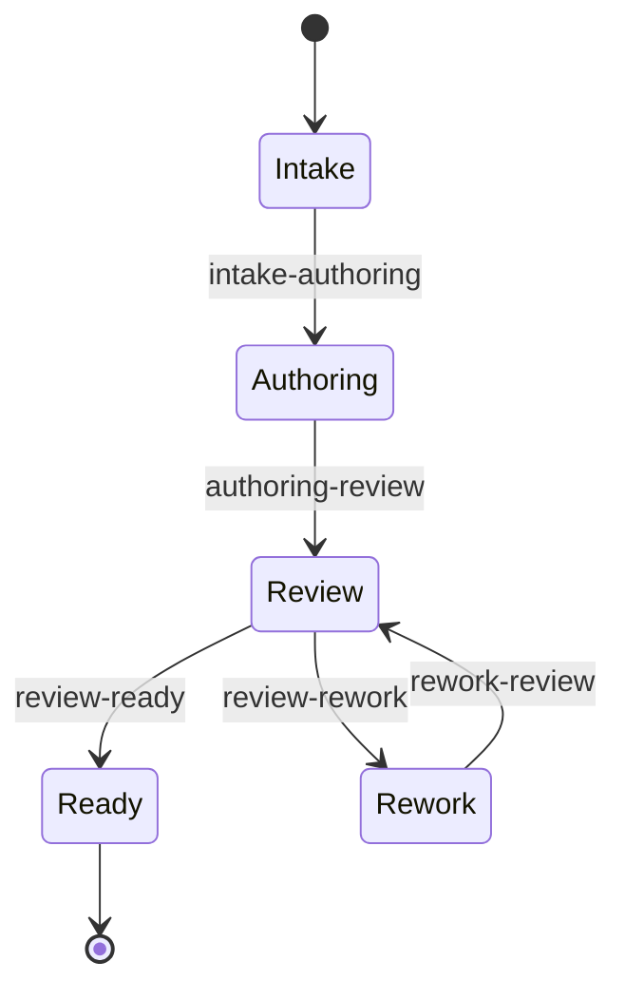

# Canonical Document Quality & Workflow Transition Specification

This specification defines the quality standards, evaluation criteria, and deterministic workflow transition gate for all Deterministic Agentic Workflow (DAW) specifications and engineering documents.

---

## 1. Overview & Architectural Role

### 1.1 Purpose

Engineering documentation in Deterministic Agentic Workflow (DAW) serves as the formal boundary contract between business intent, technical architecture, and autonomous implementation. High-quality documentation must be unambiguous, grounded in verifiable facts, free from vanity metrics, and consumable by two distinct reader audiences:

1. **Human Stakeholders:** Engineers, architects, product managers, security reviewers, and operations teams who review, govern, and maintain the system.
2. **Fresh Coding Subagents:** Autonomous LLM subagents spawned with clean context windows, zero ambient conversational history, and strict execution instructions.

### 1.2 Engineering Proposal Status: Workflow Transition Gate

This specification and its accompanying machine registry (`references/document-quality-rubric.json`) operate as an **engineering-proposal specification** and deterministic **workflow transition gate**:

- The gate governs document lifecycle state transitions through five explicit directed edges:
  `intake-authoring`, `authoring-review`, `review-ready`, `review-rework`, and `rework-review`.
- It enforces a portable, read-only Python stdlib gate (`scripts/check_docs.py` invoked via `python3 scripts/validate.py docs`).
- It avoids global process supervisors, shell hooks, daemon listeners, or runtime monkeypatching.
- It verifies **structural transition eligibility**, not internal semantic truth or actual human comprehension.
- Passing the transition gate proves that a transition record and its cited artifacts satisfy structural requirements; the validator persists no state and cannot authenticate callers, reviewers, or actual lifecycle history. The parent orchestrator holds actual workflow state.

### 1.3 Scope & Proportionality

DAW defines **14 canonical document kinds**:
`blueprint`, `brd`, `prd`, `erd`, `frd`, `techstack`, `design`, `wireframe`, `ui-ux`, `security`, `qa`, `deployment`, `runbook`, `roadmap`.

The default baseline is six kinds (`blueprint`, `prd`, `frd`, `techstack`, `security`, `roadmap`), plus a conditional ERD selected when persisted entities or relationships are introduced, materially changed, or adopted without an adequate existing model; otherwise the ERD is skipped with a scoped reason. An adequate existing separate model is reused rather than duplicated. Full-suite explicit requests cover all 14 kinds.

**There is no mandatory 14-document requirement.** Projects MUST author only the specific documents proportional to their scope, complexity, and active lifecycle stage. If a project requires only an architectural blueprint and an FRD, only those documents are selected, authored, and transitioned. Equivalent project-relative filenames are permitted for each canonical kind (for example, `docs/architecture-blueprint.md` for `blueprint` or `specs/functional-requirements.md` for `frd`).

---

## 2. Industry Standards & Practice Guidance Grounding

The DAW document quality criteria and workflow transition gate are grounded in established engineering practice guidance and industry standards.

| Source & Canonical Link                                                                                                                                                  | Focus                              | What It Supports in DAW Rubric / Gate                                                                                                                                             | Operational Limitations / Non-Goals                                                                                                                                                               |
| :----------------------------------------------------------------------------------------------------------------------------------------------------------------------- | :--------------------------------- | :-------------------------------------------------------------------------------------------------------------------------------------------------------------------------------- | :------------------------------------------------------------------------------------------------------------------------------------------------------------------------------------------------ |
| **NASA Systems Engineering Handbook (SP-2016-6105 Rev2, App C)**<br>[NASA SP-2016-6105 Rev2](https://www.nasa.gov/reference/appendix-c-how-to-write-a-good-requirement/) | Requirements engineering           | Verifiable, unambiguous requirements; bounded condition/action boundaries; separating problems from implementation bias (`brd`, `prd`, `frd`, `DQ-04`).                           | Aerospace mission formalism; does not certify agent code output or validate UI layouts.                                                                                                           |
| **Google Technical Writing: Target Audience**<br>[Google Tech Writing](https://developers.google.com/tech-writing/one/audience)                                          | Reader-centered communication      | Explicit reader roles, reader prerequisite knowledge, and core reader tasks; organizing key information without ambient memory (`DQ-01`).                                         | Human-targeted; does not model LLM context window attention limits or token degradation.                                                                                                          |
| **arc42 Architecture Documentation**<br>[arc42 Overview](https://arc42.org/overview/)                                                                                    | Modular architecture views         | Modular separation of concerns across system boundaries, building blocks, and decisions (`blueprint`, `techstack`).                                                               | Comprehensive enterprise framework; does not mandate authoring all 12 arc42 sections.                                                                                                             |
| **Documenting Architecture Decisions (Nygard)**<br>[Nygard ADR Pattern](https://cognitect.com/blog/2011/11/15/documenting-architecture-decisions)                        | Architecture Decision Records      | Recording architectural decisions with Context, Decision, and Consequences (`techstack-02`, `DQ-05`).                                                                             | Limited to architectural decisions; does not define operational runbooks or test strategies.                                                                                                      |
| **OWASP Threat Modeling Cheat Sheet**<br>[OWASP Threat Modeling](https://cheatsheetseries.owasp.org/cheatsheets/Threat_Modeling_Cheat_Sheet.html)                        | Threat discovery & mitigation      | Structured asset cataloging, trust boundaries, threat entry points, and actionable defenses (`security-01..03`).                                                                  | Methodological guide; does not prove absence of vulnerabilities or run automated audits.                                                                                                          |
| **Google Site Reliability Engineering: Release Engineering**<br>[Google SRE Book Ch 8](https://sre.google/sre-book/release-engineering/)                                 | Reproducible deployments           | Documented build/release steps, environment configuration, cutovers, and rollback playbooks (`deployment-01..03`).                                                                | Presumes distributed production infrastructure; does not prescribe single-node or CLI deployment rules.                                                                                           |
| **Google Site Reliability Engineering: Managing Incidents**<br>[Google SRE Book Ch 14](https://sre.google/sre-book/managing-incidents/)                                  | Incident triage & response         | Structured severity classification, triage escalation, and reproducible diagnostic procedures (`runbook-01..03`).                                                                 | Organizational incident management guidance; does not prevent underlying software failure.                                                                                                        |
| **Software Engineering at Google: Testing Overview (Adam Bender)**<br>[Google SWE Book Ch 11](https://abseil.io/resources/swe-book/html/ch11.html)                       | Test strategy & isolation          | Test level boundaries (unit, integration, system), environment isolation, and flakiness prevention (`qa-01..03`).                                                                 | Architectural testing philosophy; does not generate test code or verify domain logic.                                                                                                             |
| **W3C Web Content Accessibility Guidelines (WCAG) 2.2**<br>[W3C WCAG 2.2](https://www.w3.org/TR/WCAG22/)                                                                 | Visual & interaction accessibility | Exact testable accessibility criteria: text contrast (1.4.3), non-text contrast (1.4.11), Focus Visible (2.4.7), Focus Not Obscured (Minimum) (2.4.11) (`design-02`, `ui-ux-03`). | Applies to web UI presentation surfaces; not applicable to headless or CLI systems. Note: 2.4.7 ensures focus visibility; 2.4.11 ensures author content does not cover focused items.             |
| **Everything Claude Code (ECC) GateGuard Precedent**<br>[affaan-m/ECC](https://github.com/affaan-m/everything-claude-code)                                               | Fact-forcing mechanism precedent   | Historical precedent for requiring explicit empirical evidence before permitting operations.                                                                                      | Mechanism inspiration only. ECC uses runtime PreToolUse interceptor hooks; DAW uses static, read-only CLI validation without hooks. Universal LLM self-evaluation claims are explicitly rejected. |

---

## 3. Canonical Quality Rubric

The canonical machine-readable rubric is published at `references/document-quality-rubric.json` and serves as the **single authoritative source** for all 47 criterion IDs and text questions. This section summarizes the structure and reader outcomes.

### 3.1 Common Core Criteria (DQ-01 .. DQ-05)

Every document, regardless of kind, is evaluated against these 5 foundational criteria:

- **DQ-01 (Reader Role & Task):** Defines the explicit reader role and core reader task, enabling immediate orientation without ambient conversation memory.
- **DQ-02 (Observed Facts vs. Proposals):** Distinguishes observed empirical facts with verifiable provenance from proposals, assumptions, or unknowns.
- **DQ-03 (Terminology & Cross-Links):** Employs consistent domain terminology and canonical cross-links without conflicting duplicate definitions.
- **DQ-04 (Actionable Acceptance & Boundaries):** Formulates bounded, actionable acceptance criteria, failure modes, and dependencies proportional to scope.
- **DQ-05 (Scope Boundaries & Revision Context):** Clearly identifies scope boundaries, open decisions, and recorded revision context without forcing artificial dates or sign-offs.

### 3.2 Canonical Document Kinds (Summary of 3 Specific Criteria Each)

Detailed question texts are maintained canonically in `references/document-quality-rubric.json`:

1. **`blueprint` (`blueprint-01..03`):** System context and boundaries, components and responsibilities, primary interaction and data flows, domain invariants, and failure and transaction boundaries, deferring detailed persistent relationships to the separate ERD; document routing map without orphan links; cross-cutting contracts and governance invariants.
2. **`brd` (`brd-01..03`):** Core business objectives and target outcomes; stakeholder roles and workflow constraints; separation of business constraints from implementation details.
3. **`prd` (`prd-01..03`):** Primary actors/consuming systems and problem scenarios; product capabilities and flow priorities; functional success conditions and explicit non-goals.
4. **`erd` (`erd-01..03`):** Logical entities, identity, and sourced attributes; relationships with cardinality, optionality, and ownership; integrity, lifecycle, traceability, and applicable physical design only where storage choices warrant it.
5. **`frd` (`frd-01..03`):** Behavioral payload schemas with types and validation, linking the separate ERD for persistent entity identity and relationships; deterministic state transitions and event triggers; edge cases and error contracts.
6. **`techstack` (`techstack-01..03`):** Runtimes, frameworks, and storage systems with explicit versions and rationales; architectural trade-offs and decision records; dependencies and licensing boundaries.
7. **`design` (`design-01..03`):** Design tokens with semantic mappings; visual contrast and accessibility considerations (e.g. WCAG 1.4.3/1.4.11) where applicable; reusable component inventory and responsive layout rules.
8. **`wireframe` (`wireframe-01..03`):** Viewport layouts and responsive breakpoints; screen container hierarchy and spatial allocation; navigation flows, user cues, and view transitions.
9. **`ui-ux` (`ui-ux-01..03`):** Interactive component states (default, active, disabled, loading, error); interaction behaviors and progressive disclosure; keyboard navigation, ARIA semantics, Focus Visible (2.4.7), and Focus Not Obscured (2.4.11).
10. **`security` (`security-01..03`):** Sensitive assets and data boundaries; trust boundaries and threat vectors mapped to security patterns (e.g. OWASP); actionable authentication, authorization, and mitigation controls.
11. **`qa` (`qa-01..03`):** Test strategy across appropriate levels (unit, integration, system); test environments, fixtures, and isolation proportional to architecture; defect severity and regression gating rules.
12. **`deployment` (`deployment-01..03`):** Deployment topologies and release artifacts; reproducible release phases, health checks, and cutovers; rollback triggers, procedures, and migration reversibility.
13. **`runbook` (`runbook-01..03`):** Service operational profile, monitoring indicators, and alert thresholds; incident severity levels, triage paths, and roles; copy-paste executable diagnostic and recovery playbooks.
14. **`roadmap` (`roadmap-01..03`):** Sequenced, dependency-ordered work phases and milestones; critical path dependencies and integration choke-points; phase completion gates and release acceptance criteria.

---

## 4. Workflow Transition State Machine & Protocol

The document quality gate enforces an explicit lifecycle state machine governing how specifications move from inception through authoring, review, and downstream readiness.



### 4.1 The Five Allowed Directed Edges

The CLI parameter `--transition <edge>` and the record's `transition: {"from": "...", "to": "..."}` must match exactly one of the five allowed edges:

1. **`intake-authoring` (`intake` -> `authoring`):**
   - **Purpose:** Initiates document authoring. Verifies objective, scope, audience role, reader task, and grounded inception sources.
   - **File State:** Target document files **do not need to exist yet** on disk.
   - **Top Fields:** `schema_version`, `transition`, `objective`, `scope`, `documents`.
   - **Reviewer:** MUST NOT carry `reviewer`.
   - **Per-Document:** `path`, `kind`, `audience`, `reader_task`, `sources`. Does NOT carry `sha256` or `checks`.

2. **`authoring-review` (`authoring` -> `review`):**
   - **Purpose:** Submits authored documents for review. Verifies that regular UTF-8 files exist, byte SHA-256 hashes match disk bytes, and all 8 required criteria are addressed.
   - **File State:** Document file **must exist** as a regular UTF-8 file with matching SHA-256.
   - **Top Fields:** `schema_version`, `transition`, `objective`, `scope`, `documents`.
   - **Reviewer:** MUST NOT carry `reviewer` (authors cannot submit self-reviews).
   - **Checks:** Exactly 8 checks (5 common + 3 kind). Status may be `pass`, `not_applicable`, or `blocked`.
   - **Blocked Acceptance:** Grounded `blocked` checks are permitted to indicate unfinished sections or dependency blocks entering review. Checks MUST NOT carry `decision`.

3. **`review-ready` (`review` -> `ready`):**
   - **Purpose:** Downstream implementation release gate. Verifies that an independent reviewer or parent agent has evaluated all 8 criteria and accepted them.
   - **File State:** Document file must exist, with exact matching SHA-256.
   - **Top Fields:** `schema_version`, `transition`, `objective`, `scope`, `reviewer` (mandatory object `{id, kind, author_id}` with `kind` = `human`|`agent`; formal specs want `kind: human`), `documents`.
   - **Checks:** Every check MUST include `decision: "accepted"`.
   - **Status Restrictions:** Every check status MUST be `"pass"` or `"not_applicable"`. Any check with status `"blocked"` or decision `"not_accepted"` causes immediate transition rejection.
   - **Reviewer Independence:** `reviewer.id == reviewer.author_id` (after strip, casefold) is rejected as `reviewer_not_independent`; `kind: "agent"` on `review-ready` passes with a `reviewer_agent_attestation` warning. The validator still never authenticates identity.
   - **Durable Evidence:** Any `sources[].path` or `checks[].evidence[].path` whose path is not durable (first segment `tmp`/`temp`/`.tmp`/`scratch`/`.cache`, any `__pycache__` segment, or any dot segment except `.github`) is rejected as `evidence_not_durable`. The path-segment denylist cannot detect gitignored paths; see [Validator Reference](validation.md).

4. **`review-rework` (`review` -> `rework`):**
   - **Purpose:** Rejection / corrective feedback gate. Records reviewer objections and required remediation scope.
   - **File State:** Document file must exist, with exact matching SHA-256.
   - **Top Fields:** `schema_version`, `transition`, `objective`, `scope`, `reviewer` (mandatory object `{id, kind, author_id}` as in `review-ready`), `documents`.
   - **Checks:** Every check carries `decision: "accepted"` or `decision: "not_accepted"`.
   - **Rejection Requirement:** At least one check MUST carry `decision: "not_accepted"`. A review that accepts everything cannot transition to rework.

5. **`rework-review` (`rework` -> `review`):**
   - **Purpose:** Resubmission gate after author rework. Verifies updated artifacts and fresh quotes submitted for re-review.
   - **File State:** Document file must exist, reflecting reworked content with updated SHA-256.
   - **Top Fields:** `schema_version`, `transition`, `objective`, `scope`, `documents`.
   - **Reviewer:** MUST NOT carry `reviewer`.
   - **Checks:** Exactly 8 checks with status `pass`, `not_applicable`, or `blocked`. Checks MUST NOT carry `decision`.

---

### 4.2 Document Mutation & Verdict Invalidation

**A document or evidence mutation immediately invalidates any prior `review-ready` eligibility.**

- If any line in a specification file or cited source file is modified, its SHA-256 hash changes.
- The validator recalculates SHA-256 from disk bytes and verifies line-level quotes against current file text. If hashes or quotes do not match disk bytes, verification fails immediately.
- Any mutation requires the parent orchestrator to re-enter the `rework` state, submit a fresh `rework-review` transition record, and obtain a fresh `review-ready` transition record from the reviewer.
- There are no perpetual authorization tokens or lifetime exemptions.

---

## 5. Record & Evidence Schemas

### 5.1 Top-Level Transition Record Envelope (Schematic)

```json
{
  "schema_version": 1,
  "transition": {
    "from": "authoring",
    "to": "review"
  },
  "objective": "Design and document the core authentication service API contract and data model.",
  "scope": "Covers user registration, token issuance, and session revocation. Billing integration is out of scope.",
  "documents": []
}
```

_(Schematic illustration. Concrete transition records populate `"documents"` with specific document objects. The `"reviewer"` field is mandatory on `review-ready` and `review-rework` edges, and strictly prohibited on `intake-authoring`, `authoring-review`, and `rework-review`.)_

### 5.2 Evidence Citation Schema (Schematic)

Every source cited in `sources` and every evidence quote in `checks` must adhere to this exact structural format:

```json
{
  "path": "docs/architecture-blueprint.md",
  "sha256": "<64-hex-sha256-digest-of-exact-file-bytes>",
  "start_line": 12,
  "end_line": 13,
  "quote": "### Target Reader\nThis document is written for Backend Engineers implementing the service."
}
```

- `path`: Strict project-relative path to a durable regular UTF-8 file inside the project root (see §4.1 durable-evidence rule; gitignored paths are undetectable by the segment denylist).
- `sha256`: 64-character lowercase hex string matching `hashlib.sha256(file_bytes).hexdigest()`.
- `start_line` / `end_line`: 1-based positive integers, with `end_line >= start_line`.
- `quote`: Exact string resulting from `"\n".join(lines[start_line - 1 : end_line])`.

---

## 6. Operational Boundaries & Security Limitations

The DAW document transition gate enforces strict operational boundaries:

1. **Structural Transition Eligibility vs. Semantic Truth:**
   The validator evaluates whether the record complies with schema rules, whether cited lines exist in regular files, and whether hashes match disk bytes. It does **not** certify that the document's design is bug-free, that the architecture is optimal, or that requirements are completely understood. Passing the gate proves **eligibility for the declared transition**, not semantic truth.
2. **Read-Only Stateless Execution:**
   The validator never writes to the filesystem, executes child processes, makes network requests, or persists transition state. The persisted state is the project-owned `ledger.json` (validated read-only via `validate.py ledger`); the parent orchestrator holds actual workflow state.
3. **No Caller or Reviewer Authentication:**
   The `reviewer` object `{id, kind, author_id}` is opaque and self-declared. The validator checks independence (`reviewer_not_independent`) and only warns on `kind: "agent"`; it cannot verify the physical identity, cryptographic signature, or organizational independence of the reviewer. Parent workflows must independently verify reviewer competence.
4. **Human Comprehension Remains Unexercised:**
   In the absence of empirical human reading studies with real human participants, human comprehension **MUST BE EXPLICITLY REPORTED AS UNEXERCISED**. Substituting LLM self-evaluation or synthetic prompt completions as "human readability validation" is prohibited.

---

## 7. Two-Audience Evaluation Protocol

To empirically measure documentation usability and clarity across human and agent readers:

### 7.1 Evaluated Audiences

- **Audience A (Human Engineers / Stakeholders):** Human developers and architects tasked with reviewing, understanding, and implementing specifications.
- **Audience B (Fresh Coding Subagents):** Autonomous LLM subagents initialized in isolated sessions with clean context windows, zero prior conversational turns, and no access to planning memory.

### 7.2 Audience-Tailored Evaluation Tasks

Tasks must be tailored to the document's actual target reader role and scope rather than imposing arbitrary universal constraints:

1. **Targeted Information Retrieval & Constraint Mapping:**
   - _Task:_ Locate and state the exact interfaces, constraints, and error behaviors specified for the target reader's role.
   - _Measurement:_ Record elapsed retrieval time and steps without imposing a fixed universal threshold; if a time budget is used, pre-register the budget based on document size. Compare extracted facts against the specification oracle.
2. **Bounded Implementation & Test Authoring:**
   - _Task:_ Implement the designated module or test suite strictly within bounded, permitted paths without guessing missing parameters or inferring out-of-scope abstractions.
   - _Measurement:_ Zero unauthorized path modifications, zero ungrounded interface assumptions, full test pass rate against documented contracts.
3. **Operational Diagnosis, Approval Gates & Escalation:**
   - _Task:_ Follow documented runbooks to diagnose a simulated degraded condition, identifying the correct root cause and appropriate mitigation path.
   - _Measurement:_ Verifies that operational steps correctly pause at approval boundaries, invoke mandatory human confirmation, and trigger escalation paths rather than executing unapproved mutations or automatic remediation.

### 7.3 Experimental Controls & Methodology

- **Withheld Expected Answer Oracle:**
  The ground-truth answers (oracle) must be maintained separately from the evaluation environment and strictly withheld from evaluating agents during the test run.
- **Negative Controls & Transparent Failure Reporting:**
  Test suites must include negative controls (intentionally flawed, ambiguous, or incomplete specifications). Evaluators must explicitly record and report whether the reader or reviewer detected the defect; detected failures must be documented transparently rather than hidden or treated as evaluation invalidation. Automated CLI gates only evaluate structural eligibility, so semantic defect detection remains the responsibility of the reviewer.
- **Fresh Context Windows & Contamination Disclosure:**
  Subagents must be evaluated in isolated runs without prior conversation history. Because fresh sessions do not erase pre-existing host environment artifacts, global caches, or training-data exposure, any potential background context contamination must be explicitly disclosed in the evaluation report.
- **Honest Human Reporting:**
  Unless empirical testing was conducted with actual human participants who performed the evaluation tasks, all summary reports and scorecards must label human comprehension as `[UNEXERCISED: NO HUMAN PARTICIPANTS]`.

---

## 8. CLI & Validator Reference

For detailed command-line arguments, exit codes, JSON envelope specifications, and integration patterns, refer to the canonical validator reference in `references/validation.md`.

---

<a id="feature-delivery-contract"></a>

## 9. Feature Delivery Contract

This section defines the canonical procedural contract governing end-to-end feature delivery across the Deterministic Agentic Workflow (DAW) specification matrix. It integrates core specification-driven development mechanisms into existing DAW modules, preserving DAW's root router governance, read-only review/ask boundaries, fail-closed human authorization, parent-owned acceptance records, and default user-facing report separation. It requires no new route stages, modules, external daemons, or synthetic file formats.

Existing project file naming, issue tracking, and directory structures are respected; there is no mandate to create artificial `spec.md`, `plan.md`, `tasks.md`, or `constitution.md` files when equivalent canonical documents (`prd.md`, `frd.md`, `blueprint.md`, `roadmap.md`) already exist. Trivial settled bug fixes or localized patches may keep mappings inline without forcing multi-document expansion.

<a id="a-governance-authoring"></a><a id="a-governance-and-authoring-alignment"></a>

### A. Governance & Authoring Alignment

1. **Consume Real Project Principles:** Authoring modules (`daw-design`, `daw-wizard`, or manual drafting) MUST consume actual project governance, architecture baselines, and design requirements from existing repository documents (e.g., `blueprint.md`, `constitution.md`, architectural decision records, or existing specifications). Never invent organizational policies, arbitrary owners, fictional approvals, or vanity metrics.
2. **Distinguish What/Why from How:** Specifications (e.g., `prd.md`, `frd.md`) MUST articulate business requirements, user problem statements, and acceptance constraints (_what_ and _why_), leaving technical implementation mechanisms, schema layouts, and algorithms (_how_) to architecture and execution plans. Detail ceiling: PRD/FRD/blueprint prose contains no DDL, function bodies, migrations, or file paths; entity identity/relationships live in `erd.md`; interface shapes live in the FRD interface table; a decision-rich shape may be quoted only when prose cannot express it, labeled as a decision.
3. **Record Source Provenance & Status:** Trace every principle or constraint to its authoritative repository source or human input. Explicitly distinguish _proposed/default_ options from _decided_ architectural choices.
4. **Impact Analysis on Principle Changes:** When a foundational principle, architectural constraint, or design decision is modified, the authoring agent MUST enumerate all affected documents, tasks, and acceptance evidence. Authorized artifacts must be synchronized. Silent overriding of established principles or sneaking feature implementation into governance-only edits is strictly prohibited.
5. **Preserve Existing Scope Guard:** Speculative additions, unrequested refactorings, or unauthorized scope creep remain strictly blocked by existing scope guards.
6. **Persist Authoritative Specification Before Tactical Decomposition (multi-step work):** For multi-step authorized work, a proportional authoritative specification (what/why/non-goals/acceptance criteria) MUST be persisted before tactical decomposition, per [Workflow Artifacts](workflow-artifacts.md) §1–§2. Reuse an existing adequate spec; do not duplicate it. If clear user requirements have no written source, the authorized parent records their faithful bounded what/why/non-goals/AC in the chosen spec before planning — the planner cannot invent architecture or business choices. Ambiguity returns to the existing design/clarification route; no new design insertion is created for a clear route. Tiny settled patches and factual/read-only inquiries retain the no-document path. A chat payload or native todo alone cannot substitute for the saved specification.

<a id="b-clarify"></a><a id="b-clarification-and-technical-uncertainty-resolution"></a>

### B. Clarification & Technical Uncertainty Resolution

The clarification **transport** — capability discovery of the harness's actually-exposed interactive question tool, pre-tool context, per-round bounds, tool-supplied recommendation/custom/free-text/multiselect semantics, cancellation-as-unresolved, text fallback, approval-bypass prohibition, and the `wizard_bench.py` file-oracle adapter exception — is NOT restated here. It is governed solely by the canonical shared rule in [Native Interactive Clarification Transport](grilling.md#native-interactive-clarification-transport-canonical-rule) in `references/grilling.md`, which applies to all DAW decision workflows. This section governs only the clarification **content** (what to ask and how to record answers):

1. **Repo Inspection First:** Before querying the human operator or creating clarification tickets, agents MUST inspect existing repository facts, codebase structures, and documentation (consulting commit history when needed). Never ask questions that repository files or existing specifications already answer. Material unknowns only; no redundant confirmations.
2. **Prioritize by Impact × Uncertainty:** Rank unresolved ambiguities by $\text{Impact} \times \text{Uncertainty}$. Do not ask low-leverage questions about stylistic preferences, variable naming, or internal module boundaries. Do not present false dichotomies.
3. **Structured Question Batching (content):** For dependent architectural trade-offs, ask one question at a time to avoid cascading invalidation. For genuinely independent decisions, batch up to 5 clear, high-leverage choices per round. Per-round caps, dependency ordering, and schema limits are enforced by the canonical transport rule above, not by this section.
4. **Research Technical Uncertainties First:** If an ambiguity stems from technical feasibility, library capabilities, or API behaviors, research technical facts before consulting the user. Record the resulting decision, technical rationale, considered alternatives, and primary sources directly into the appropriate existing document section (e.g., in `prd.md`, `blueprint.md`, or `frd.md`; no mandatory standalone `research.md`).
5. **Authoritative Specification Updates & Read-Only Separation:** Clarification answers MUST be recorded into the authoritative specification by the authorized authoring module (`daw-design`/`daw-wizard`). Conflicting text must be reconciled and affected acceptance criteria updated. Unresolved items remain explicit unknowns that block only dependent scope. Read-only inquiry modules (`daw-ask`) MUST NOT write files; they return proposed exact text updates to the parent orchestrator for routing to the authorized authoring module. Cancelled/unanswered clarification is unresolved, never default consent.

<a id="c-feature-slice"></a><a id="c-feature-slicing-and-behavioral-contract-oracles"></a>

### C. Feature Slicing & Behavioral Contract Oracles

1. **Stable Identifier Preservation:** Preserve existing stable identifiers for requirements, user stories, and acceptance criteria (`REQ-xxx`, `US-xxx`, `AC-xxx`). If identifiers are absent in legacy documents, generate unique, scoped identifiers and retain them consistently across all downstream artifacts.
2. **Prioritized Demonstrable Behavior Stories:** Decompose features into prioritized, independently demonstrable and testable behavior slices. Each story must define verifiable contract oracles — express acceptance criteria per the canonical [EARS Semantic Guidance](#acceptance-criteria-ears) (five forms with composition allowed; Given/When/Then equivalent) or as explicit input, output, error state, and postcondition assertions carrying the same observable condition, response, and oracle. Priorities MUST be distributed (not everything P1/Must); each story carries Why-this-priority and Independent Test; P1 alone is a viable demoable slice. Each AC states its oracle source (spec literal or worked example, never recomputed the way the code computes it). At most 3 material unresolved decisions per document remain as `[Open Question]` with owner/trigger; everything else is a labeled `[Proposed Default]`. Choose the fewest, highest existing test seams (public interfaces) where behavior will be verified.
3. **Transactional & Safety Invariants:** Do not force artificial deployment independence for inseparable transactional, data-integrity, or security invariants that must land together atomically.
4. **Explicit Out-of-Scope & Measurable Non-Functional Criteria:** Define explicit out-of-scope boundaries to prevent scope expansion. Non-functional, performance, security, and negative/edge-case criteria must be empirically measurable with verified or proposed target provenance.
5. **Infrastructure Task Justification & KPI Boundaries:** Supporting infrastructure or refactoring tasks may exist without an end-user story ONLY when backed by an explicit, justified prerequisite dependency. Business outcome goals and high-level KPIs do not serve as build/runtime acceptance criteria unless bounded by a concrete, observable system measurement boundary.
6. **Spec Self-Review Before the Transition Gate (bounded):** At most 3 rewrite cycles; residue recorded as Open Question. Checks: placeholder scan, internal consistency, ambiguity, scope (decompose multi-subsystem specs), detail-ceiling check, cross-document entity/type name diff.

<a id="acceptance-criteria-ears"></a>

#### Acceptance Criteria: EARS Semantic Guidance (Canonical)

This is the single canonical source for how acceptance criteria are expressed. Templates (`prd`, `frd`, `qa`) link here and add only compact fields/checks; they MUST NOT restate competing persistence or format rules.

Each criterion MUST state an **observable condition, observable response, and oracle**: the trigger/state that is checked, what the system observably does, and how a verifier proves it (command output, state readback, error code, file/DB read, or other durable evidence). Semantic clarity is the acceptance bar — not keyword counts, not five-pattern coverage, not format ritual.

**The five EARS forms (choose the form that fits the behavior; composition is allowed):**

1. **Ubiquitous:** `THE SYSTEM SHALL <observable response>` — always true (e.g., audit log written for every export).
2. **Event-driven:** `WHEN <trigger event> THE SYSTEM SHALL <observable response>` — most criteria use this form.
3. **State-driven:** `WHILE <state/condition> THE SYSTEM SHALL <observable response>` — the system behaves that way as long as the condition holds.
4. **Optional feature:** `WHERE <feature/config is available> THE SYSTEM SHALL <observable response>` — applies only when the feature exists.
5. **Unwanted behavior:** `IF <unwanted condition or invalid input>, THEN THE SYSTEM SHALL <observable response>` — names the error/rejection response for the bad case (e.g., invalid input returns a specific error and leaves stored state unchanged).

Composition is allowed and common (e.g., `WHEN <event> WHILE <condition> THE SYSTEM SHALL <response>`) when one form alone would misstate the trigger; composition supplements the five forms but never replaces the unwanted-behavior form. Do NOT force every criterion through all five patterns.

Illustrative example (proposed, not a binding existing fact): `WHEN an export is requested with an unreadable source, THE SYSTEM SHALL return error E_SOURCE_UNREADABLE and leave exports unchanged.` The error identifier is illustrative only; use the repository's actual error identifier for the behavior.

**Authoring rules:**

- **One behavior per criterion where practical.** If a criterion carries two independently verifiable responses, split it. Combined criteria obscure the oracle and hide partial failure.
- **Meaningful error / no-change distinction.** Error-path criteria MUST name the observable error (code, status, message, or exit class) AND the no-change side effect where one exists (no rows persisted, no external call made, input artifact untouched). Do not invent side effects the behavior does not have.
- **No invented numeric or business policy.** Numeric thresholds (latency, counts, retries, timeouts) and business limits (fees, quotas, cutoffs) appear only with a traceable source (user direction, repository constant, or decided spec). Anything else is an open question or proposed default, never a silent number in a SHALL.
- **Given/When/Then equivalence.** Given/When/Then is a valid expression of the same observable contract (Given = precondition/state, When = trigger/event, Then = observable response/oracle). Use either EARS or Given/When/Then per criterion; do not require a keyword parser as truth.
- **No forced five patterns or keyword validation.** Validation checks whether an independent reader can state the trigger, response, and oracle — never whether the prose contains `WHEN`, `WHILE`, `WHERE`, or `IF/THEN`. Synonyms and concise prose that carry the same three elements are acceptable.

<a id="d-traceability-task"></a><a id="d-traceability-dependency-graph-and-parallel-safety"></a>

### D. Traceability, Dependency Graph & Parallel Safety

1. **Compact End-to-End Traceability Matrix:** Existing feature plans and roadmaps (`roadmap.md`, `plan.md`) MUST maintain a compact traceability mapping linking: `Requirement / AC ID` -> `User Story (if applicable)` -> `Task ID` -> `Target File Paths` -> `Dependencies` -> `Verification Command / Expected Outcome` -> `Observed Status / Evidence Reference`. This may be formatted as a concise Markdown table or structured task fields.
2. **Strict Gap vs. N/A Semantics:** Marking an acceptance criterion as `N/A` is permitted ONLY with an explicit, reasoned rationale demonstrating why it is non-buildable or genuinely out-of-scope. A missing task mapping is a blocking specification gap, never an implicit `N/A`.
3. **Empty Evidence Before Execution:** Evidence references and status records MUST remain empty or explicitly unexercised until the verification command actually runs. A checked task checkbox (`[x]`) or the existence of a command string does NOT constitute proof of completion.
4. **Many-to-Many Task Coverage:** A single task may satisfy multiple acceptance criteria; artificial 1-to-1 task proliferation is discouraged.
5. **Strict Dependency Order & Safe Parallelism:** Foundational setup and infrastructure dependencies must strictly precede dependent user story tasks. Tasks marked for parallel execution (`[P]`) are permitted ONLY when they involve disjoint target file writes AND share no concurrent data mutation or runtime execution dependencies. The orchestrator must reject dependency cycles, missing prerequisites, and shared ownership conflicts before dispatching parallel subagents; independent authorized tasks may proceed concurrently.
6. **Persisted Plan Before Build Dispatch:** For multi-step work, the plan mapping stable requirement/AC IDs to task IDs, exact target files, dependencies, parallel ownership, expected observations/check actions, evidence slots, and separate parent acceptance MUST be saved before build dispatch, per [Workflow Artifacts](workflow-artifacts.md) §1–§2. Reuse an existing roadmap/issue-export/project doc section when sufficient; otherwise use the default `docs/plans/<workflow-id>.md`. A chat payload or native todo is insufficient. Include the artifact reference in existing handoff `details` without changing the outer JSON schema; there is one artifact authority only — no duplicate task-tracker authority.

<a id="e-requirements-quality-checklist"></a><a id="e-requirements-quality-checklist-and-review-separation"></a>

### E. Requirements-Quality Checklist & Review Separation

1. **Reviewer-Owned Quality Judgment:** The requirements-quality checklist represents independent reviewer judgment regarding prose completeness, clarity, testability, consistency, and verifiability. It is fundamentally distinct from the builder's task execution checklist and runtime acceptance proofs.
2. **No Extra Files or Schema Modifications:** Quality evaluation adapts existing document quality criteria (Section 2/3 of this specification) and review rubrics without requiring auxiliary checklist files or altering the outer JSON schema.
3. **Prohibition of Self-Approval:** Implementing builder subagents and authoring agents MUST NOT check off reviewer criteria to approve their own work. Reviewer gates require independent evaluation.
4. **No Blanket Overrides of Gate Failures:** Known blocking requirement gaps, missing acceptance criteria, or transition gate failures cannot be bypassed by generic user utterances like "proceed", "looks good", or "continue anyway". Legitimate changes in scope require explicit specification updates.
5. **No Requests to Relax Test Rigor:** Agents MUST NOT ask the user or reviewer to weaken tests, waive proof requirements, or remove acceptance criteria simply to bypass stubborn failures.

<a id="f-prebuild-cross-artifact-analysis"></a><a id="f-prebuild-cross-artifact-analysis-and-readiness-checkpoint"></a>

### F. Prebuild Cross-Artifact Analysis & Readiness Checkpoint

1. **Plan Self-Check vs. Independent Readiness Review:**
   - **Plan Self-Check:** During `daw-plan`, the planning agent performs an internal readiness self-check ensuring that tasks cover all requirement IDs, dependencies are acyclic, and verification commands are specified.
   - **Independent Readiness Checkpoint:** Before initiating code-mutating implementation (`daw-build`), the parent orchestrator dispatches an independent, read-only conformity review (`daw-review`) scoped strictly to the current revisions of the specification, architecture, and plan artifacts.
   - **No Synthetic Route Stages or Recursion:** This readiness check operates as a bounded, parent-orchestrated checkpoint. It does NOT insert a new stage into the canonical routing pipeline, does NOT invoke recursive router calls, and does NOT declare a code audit or completed postbuild review.
2. **Cross-Artifact Evaluation Scope:** The readiness review compares:
   - Scope and governance alignment across `prd.md`, `blueprint.md`, and `roadmap.md`.
   - Contradictions, terminology mismatches, or ambiguities between specs and plan.
   - Orphan tasks (tasks with no requirement source) and unmapped criteria (requirements with no task).
   - Dependency ordering and parallel dispatch safety (`[P]` flag safety).
   - Source freshness (verifying cited files and commit baselines exist and match).
   - Requirements-quality checklist compliance.
   - **Named passes** (run each explicitly): duplication, ambiguity (vague adjectives without metric), underspecification, coverage gaps (requirement/SC with buildable work but no task), inconsistency including entity-set diff across spec/ERD/plan. Keep the existing exact-totals rule; no finding cap.
3. **Structured Finding Format:** Readiness findings MUST be reported in compact Markdown containing:
   `Finding ID | Severity (blocking / nonblocking) | Location | Consequence | Concrete Repair Action`.
   If coverage ratios or percentages are cited, the exact numerator, denominator, and excluded items must be stated; fabricated or guessed percentages are strictly prohibited.
4. **Deterministic Gate Outcomes & Route-Required Postbuild Review Preservation:**
   - Blocking findings (e.g., missing mandatory criteria, circular dependencies, unsafe parallel writes) halt the workflow as `blocked` until repaired.
   - Nonblocking advisories are recorded for parent visibility.
   - The parent orchestrator owns final acceptance of readiness findings.
   - Route-required postbuild review remains distinct; a prebuild checkpoint cannot satisfy it. For routes that explicitly mandate postbuild review (`feature`, `bugfix`), passing this prebuild readiness checkpoint NEVER replaces or waives postbuild `daw-review`, which audits the actual modified codebase and runtime evidence after implementation. Do NOT insert `daw-review` into routes that do not require it (e.g., `patch` pipeline is `daw-build` -> `daw-verify`). Verification is always performed per the active route.
5. **Direct Fallback with Evidence Limits:** If an independent subagent reviewer cannot be spawned, the orchestrator performs an honest, direct cross-artifact check in the current session, explicitly documenting the limitation in the handoff evidence.
6. **Ranked Result Triage After Worker Results:** Every completed worker result is parent-ranked into a prioritized fix queue before acceptance or fix dispatch, per [Ranked Result Triage](operations.md#ranked-result-triage): verify evidence against the current revision, dedup/noise-filter overlapping findings, order by severity, urgency, and dependency unblock effect, and close only via parent acceptance with integration proof. Triage never authorizes external deployment automatically. The queue mechanics live in operations; this section does not duplicate the gate.

<a id="g-convergence-change-impact"></a><a id="g-convergence-drift-analysis-and-scoped-invalidation"></a>

### G. Convergence, Drift Analysis & Scoped Invalidation

1. **Three-Way Drift Inspection:** Adoption (`daw-setup`) and verification (`daw-verify`) modules MUST inspect three data sources: (1) actual working tree code, (2) authoritative specification/contract documents, and (3) current observable runtime evidence.
2. **Four-State Convergence Classification:** Features and requirements must be classified into one of four deterministic states based on **consequence**, not on the drift category alone:
   - `implemented_verified`: Code exists and fresh runtime verification evidence satisfies the acceptance oracle.
   - `implemented_unverified`: Code exists, but verification has not run, evidence is stale, or tests are missing.
   - `missing`: Required code, configuration, or tests do not exist in the working tree.
   - `contradicted`: Existing code or tests directly violate authoritative specification constraints.
   - (_Blocked items_ lacking dependencies or authorization are tracked as `blocked`).
     _Severity by consequence:_ a classification describes what kind of drift it is; the **consequence** of that drift drives the severity/urgency in [Ranked Result Triage](operations.md#ranked-result-triage). `missing`, `contradicted`, and `implemented_unverified` do not map to a fixed severity automatically: the same label can be `BLOCKER`, `HIGH`, `MEDIUM`, or `LOW` depending on whether it breaks a safety invariant, blocks a dependent path, or is a non-blocking polish gap. Use the labels to name the drift type and the consequence to set the rank.

3. **Evidence Over Artifact Existence:** The existence of source files, green tests from prior commits, or checked markdown checkboxes does NOT prove convergence. Only fresh, observable runtime execution against the current code revision constitutes proof.
4. **Parent-Authorized Plan Updates Without Duplication:** When drift is detected, the parent orchestrator authorizes targeted task updates. The planning agent MUST preserve existing task IDs and history, append only genuine uncovered work within accepted scope, and avoid duplicating already pending tasks or repeating identical missing work across iterations. Review and verification modules MUST NOT perform automatic code edits or unprompted scope expansions.
5. **Scoped Invalidation Mechanics:**
   - **Code Mutations:** When source code is modified, all affected runtime verification evidence and postbuild reviews are invalidated. Re-verification and review must re-execute proportionally against the updated revision.
   - **Formal Document Mutations:** When formal, accepted specification documents mutate, they MUST re-enter the existing five-edge document transition gate (`review-rework` $\rightarrow$ `rework-review` $\rightarrow$ `review-ready`). Agents MUST NOT invent a non-existent transition named `rework`.
   - **Code-Only Changes Do Not Invalidate Docs:** Modifying implementation code does not invalidate accepted specification documents or force specifications back through the document quality transition gate unless the specification itself is altered.
   - **Targeted Approval Invalidation:** Prior operator approvals are invalidated ONLY when their specific action, target environment, code revision, or operational scope changes—never by blanket, unrelated workspace updates.
6. **Bounded Repair Cycles:** Repair and review iterations are bounded by existing workflow retry limits (see the [Fix-and-Rereview Loop Protocol](../skills/daw-review/SKILL.md#4-fix-and-rereview-loop-protocol)); unbounded or infinite convergence loops are strictly prohibited.
7. **Ranked Result Triage for Drift Findings:** Parent-ranked triage of drift and worker findings follows [Ranked Result Triage](operations.md#ranked-result-triage) — current-revision evidence, dedup/noise filter, severity plus urgency plus dependency order, parent acceptance and integration proof. Drift classifications from item 2 name the drift type; consequence sets severity and rank (see item 2 note).

<a id="h-pause-resume"></a><a id="h-scoped-pauseresume-and-canonical-block-state"></a>

### H. Scoped Pause/Resume & Canonical Block State

1. **Use Existing Canonical Statuses:** Pausing and resuming operations utilize existing canonical handoff outer statuses (`pass`, `fail`, `blocked`) and parent acceptance decisions (`accepted` / `not accepted`) per [Parent Acceptance Checkpoint](operations.md#parent-acceptance-checkpoint) (item 7). Do not create synthetic or ad-hoc status strings. Internal document-transition labels (`authoring`, `review`, `rework`, `ready`) and convergence labels (`implemented_verified`, `implemented_unverified`, `missing`, `contradicted`, `blocked`) may be used where those contracts apply, but they are not outer handoff statuses.
2. **Canonical Block on Missing Information:** When execution cannot proceed due to missing material decisions, unanswered human clarifications, failed preflight checks, or ungranted high-risk approvals, the affected node MUST halt with canonical status `blocked`.
3. **Structured Pause Record in Handoff & Acceptance:** The pausing agent or parent orchestrator MUST record the halt in the existing authorized record (parent acceptance record or module handoff details):
   - `blocked_reason`: Specific cause of the block.
   - `responsible_party`: Human operator, architect, or external dependency owner.
   - `pending_question_or_decision`: Exact question or prerequisite needed.
   - `next_permitted_action`: Concrete action permitted upon unblocking.
   - `current_revisions`: Pinned commit hash or file hashes of current artifacts.
   - `pending_dependencies`: Outstanding tasks or prerequisites.
   - `verified_evidence`: Evidence collected prior to the pause.
4. **Non-Interactive Execution Rules:** In non-interactive or automated environments, the absence of an immediate human answer MUST NOT be treated as tacit approval. The workflow halts as `blocked`.
5. **Pre-Dispatch Revalidation on Resume:** When a paused workflow is resumed, the orchestrator MUST re-evaluate the execution context before dispatching tasks:
   - Verify that the blocking condition is resolved.
   - Re-check that target revisions, scope boundaries, and preflight prerequisites remain valid.
   - Verify that required human approvals have been explicitly granted at the point of risk.
6. **No Phantom Daemon Guarantees:** Agents must not promise persistent background monitoring, automated process wake-ups, or daemon supervisors unless the host harness natively provides and demonstrates them.
7. **Progress Record Ownership on Block/Resume:** The parent-owned durable progress record ([Workflow Artifacts](workflow-artifacts.md) §3) is the authority for block/resume state; the parent is sole owner and workers return proposals only, read-only roles never write. On resume, revalidate current spec/plan revisions and preserve retry state per [Workflow Artifacts](workflow-artifacts.md) §4. Internal lifecycle terms (`authoring`, `review`, `rework`, `ready`) describe the document transition gate (§4), not parent workflow progress — do not conflate the two.
   <a id="i-integration"></a><a id="i-local-toolchain-integration-and-reusable-verification"></a>

### I. Local Toolchain Integration & Reusable Verification

1. **Reuse Existing Local Tooling & Conventions:** Execution and verification MUST reuse the project's native build systems, test suites, linter configurations, issue templates, and discovered CLI commands (e.g., `npm test`, `pytest`, `cargo test`, `make`). No external skill package, framework, or proprietary toolchain is required.
2. **Execution and Inspection Mandatory:** Merely formatting, echoing, or printing a verification command or hook is NOT execution. Verification requires executing the actual command, inspecting exit codes, capturing stdout/stderr, and verifying persistent state side effects on disk or environment.
3. **Local Overrides Cannot Weaken Core Gates:** Local project conventions, custom scripts, or template overrides MAY specialize execution details, but MUST NOT weaken or bypass canonical safety invariants, preflight checks, fail-closed risk gating, or semantic verification rules.
4. **No Autonomous External Mutations:** Creating external GitHub issues, pushing Git branches, opening pull requests, or triggering remote deployments requires explicit human authorization. Agents MUST NOT perform automated external mutations autonomously.
5. **Documented Adaptation & Intentional Exclusions:** When adopting upstream workflows (such as Spec Kit patterns), documentation must explicitly map adopted mechanisms and record intentional exclusions (e.g., not adopting upstream tests-optional default or generic checklist bypass; preserving DAW behavioral proof gates and rejecting persistent background daemons) with pinned source citations, without claiming universal perfection.
